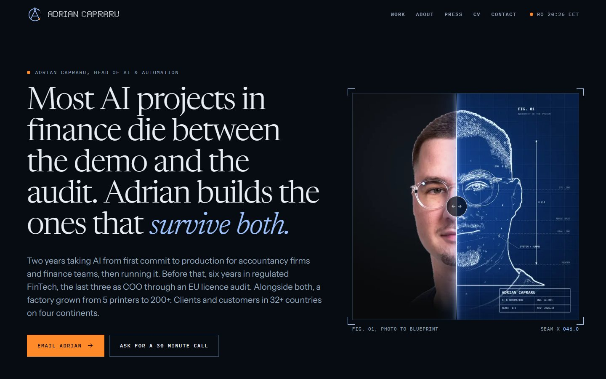
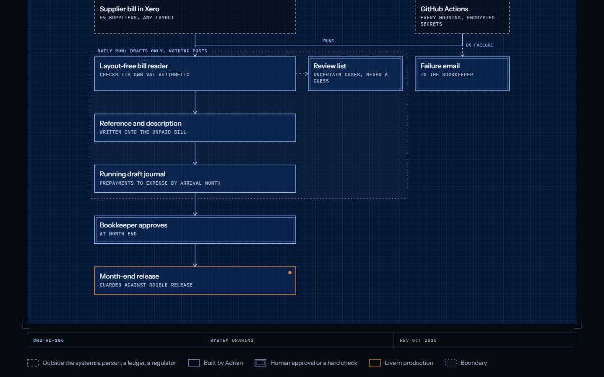
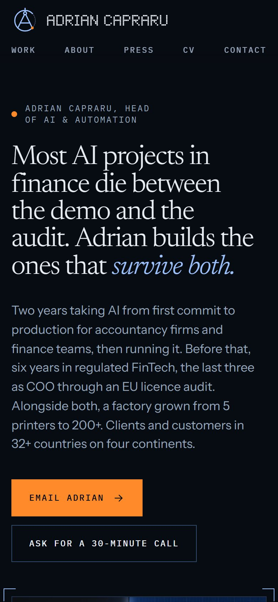

# Adrian Capraru - personal site

**[adriancapraru.com](https://adriancapraru.com)**: the portfolio of a Head of AI & Automation, built as an engineering drawing set that comes alive. Prussian blueprint sheets, drafting-white line work, mono annotations, title blocks, and one signal colour reserved for anything live in production.



<table><tr>
<td width="68%"></td>
<td width="32%"></td>
</tr></table>

What is in it:

- **Seven long-form case studies**, each with a system drawing generated from a spec in `src/content.mjs`: a wide sheet on desktop and a single column on phones, drawn in on scroll. The drawing engine is published separately as [blueprint-svg](https://github.com/cadi27tech/blueprint-svg); the write-ups also live in [production-case-studies](https://github.com/cadi27tech/production-case-studies).
- **One content file, many outputs.** `src/content.mjs` and `src/resume.json` build every page, the JSON-LD, the sitemap, `/resume.json` and `/llms.txt`, so the CV, the site and the machine-readable profile cannot disagree.
- **Progressive motion.** Every page is complete HTML; GSAP, ScrollTrigger and Lenis are vendored and only add behaviour. With JS off or reduced motion on, everything renders in its final state.
- **QA as part of the build.** `npm run qa` drives Chrome through Playwright at 1440 and 390 px, in reduced-motion and motion passes: status codes, horizontal overflow, console errors, LCP and CLS, and a card-to-case navigation through the view transition.

<picture>
  <source media="(max-width: 600px)" srcset="docs/architecture-m.svg">
  
</picture>

## Maintainer notes

Static site with a motion layer. Live at https://adriancapraru.com/ (GitHub Pages, repo `cadi27tech/cadi27tech.github.io`). Design system, palette, type and motion rules: `DESIGN.md`.

## Where things live

| What | File |
|---|---|
| Identity, hero numbers, "What Adrian builds", the "Blueprint to production" pipeline, method, principles, press list, the 7 case studies, the /cv "0 to 100" arc per role (`cvArcs`, keyed by the `work[].name` in resume.json) and the recognition list | `src/content.mjs` |
| Roles, education, all certifications (with credential IDs and verify links), skills. Single source for the timeline, the credential wall, /about, /cv, `/resume.json`, `/llms.txt` | `src/resume.json` (JSON Resume 1.x) |
| Page templates, JSON-LD, sitemap, robots, llms.txt | `src/build.mjs` |
| Styles, tokens, CSS-only hero reveal and preloader, reduced-motion fallbacks | `src/assets/site.css` |
| Motion and interaction layer (seam slider, Lenis, ScrollTrigger scenes, counters, cursor, magnetic buttons, tilt, canvas atmosphere, copy-email toast) | `src/assets/js/main.js` |
| GSAP, ScrollTrigger and Lenis, vendored (no CDN at runtime) | `src/assets/vendor/` |
| Fonts (self-hosted, OFL: Newsreader + italic, Instrument Sans, IBM Plex Mono) | `src/assets/fonts/` |
| Portrait layers (photo and blueprint, 640/1000/1400 webp), favicon, OG images, apple-touch-icon, CV PDF | `src/static/` (copied to the site root) |

Facts must come from `deliverables/V3-BRIEF.md` and `research/09d-achievement-bank.md` in the parent project. Rules: ASCII hyphen only (no em or en dashes, code comments included), clients by type never by name, never name manufacturing partners, no phone number, "four continents" only, never print a HighCrowd funding figure.

## How the motion is built

- Every page is complete HTML. JS only adds behaviour; with JS off or `prefers-reduced-motion: reduce`, everything renders in its final, readable state.
- The preloader (first visit per session) and the hero split-text reveal are pure CSS, so they can never get stuck.
- Desktop with a fine pointer: Lenis smooth scroll, pinned pipeline, pinned horizontal case rail, custom cursor, magnetic buttons, card tilt. Touch: native scroll, swipe carousel, on-view reveals.
- Page transitions: cross-document View Transitions; the case figure plate morphs from card to case hero (`view-transition-name: c-<slug>`).
- JS budget: about 52 KB gzipped for GSAP + ScrollTrigger + Lenis, plus about 7 KB for `main.js` (about 58 KB in total).

## Common updates

- **Change a number or a sentence:** edit `src/content.mjs` or `src/resume.json`, then `npm run build`.
- **Add a case study:** add an object to `work` in `src/content.mjs` (copy an existing one), then `npm run og` to create its OG image. Slug = URL.
- **Add a certification:** add it to `certificates` in `src/resume.json` with `name`, `issuer`, `date`, `id`, `group` and `url` (only if the issuer has a public verify page). It appears on home, /about, /cv, resume.json and llms.txt.
- **Add a press article:** add it to `press` in `src/content.mjs`. Only add a `url` that returns the article.
- **Replace the CV PDF:** copy the new file over `src/static/cv.pdf`.
- **Replace the portrait:** regenerate the pixel-aligned layers as `src/static/img/portrait-{photo,blueprint}-{640,1000,1400}.webp`, then `npm run og`.
- **Bump the "Updated" date:** `meta.lastModified` in `src/resume.json` (also used for sitemap lastmod).

## Commands

```
npm install        # dev only: Playwright (OG + QA), and the npm sources of the vendored libraries
npm run build      # writes dist/
npm run serve      # build, then preview on http://localhost:4321
npm run vendor     # refresh src/assets/vendor/ from node_modules after upgrading gsap or lenis
npm run og         # regenerate src/static/og/*.png and apple-touch-icon.png
npm run qa         # QA into qa/: see below
```

`npm run qa` runs two passes at desktop (1440x900) and mobile (390x844):
1. Reduced motion: full-page screenshots of home, work, two case studies, about, press, CV and contact; checks status, horizontal overflow and console errors.
2. Motion: the home page as a visitor sees it. Preloader clears, seam slider keyboard check, LCP and CLS, viewport screenshots down the whole scroll (pins, scrubs, counters), and a card-to-case navigation through the view transition.

`node scripts/qa.mjs https://adriancapraru.com` runs the same QA against the live site.

## Deploy

Push to `main`. The workflow in `.github/workflows/pages.yml` runs `node src/build.mjs` (no install step; the libraries are vendored) and publishes `dist/` to GitHub Pages. On this Windows machine: `git -c http.sslBackend=schannel push`.

Before pushing, scan for secrets and client names (see the parent project's scan list), because the repo is public.
